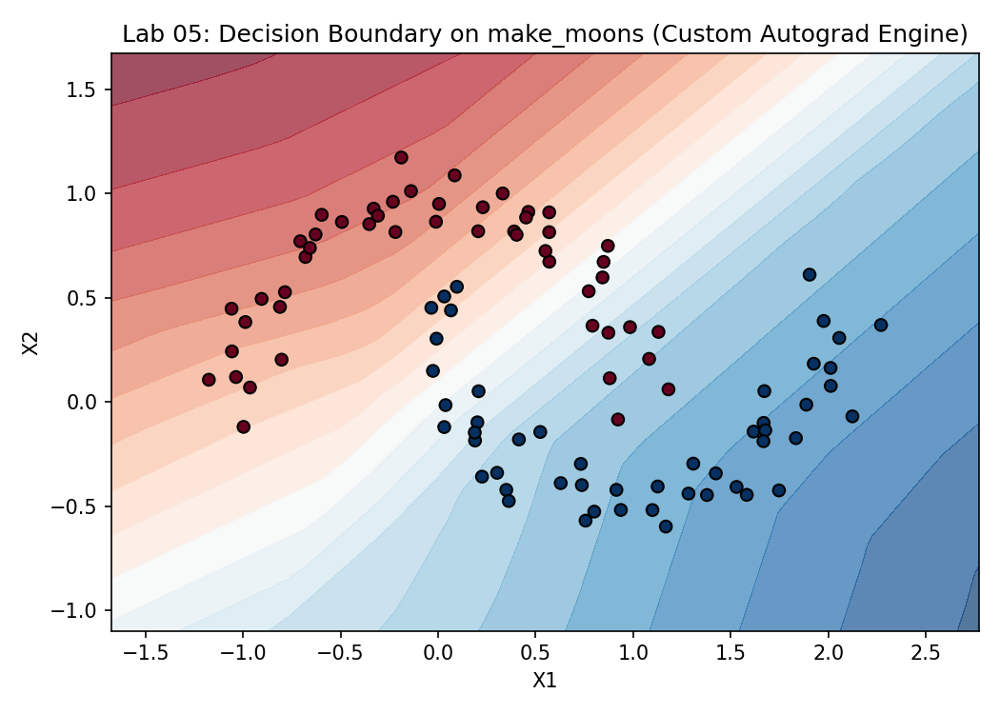

# Lab 05 Report: Automatic Differentiation and Framework Execution

## 1. Goal
The goal of this lab is to understand how deep learning frameworks work under the hood. We built a scalar automatic-differentiation (autograd) engine from scratch, validated its gradients against PyTorch and numerical calculus, trained a small neural network on the two-moons dataset, compared eager execution against traced execution, and measured the performance penalty of non-contiguous tensor memory layouts.

## 2. Implementation Overview

### Custom Scalar Autograd Engine (`Value` Class)
We built a scalar computation node that stores:
- `data`: The raw numerical scalar.
- `grad`: The accumulated derivative of the loss with respect to this value.
- `_prev`: Pointers to the parent nodes that created it.
- `_backward`: The local calculus chain rule function.

We implemented addition, multiplication, powers, ReLU, sigmoid, and log. During the forward pass, using these operations dynamically connects parent nodes to build a directed acyclic computation graph.

### Topological Backpropagation
Our `.backward()` method implements backpropagation in three steps:
1. Performs a topological sort of the computation graph using depth-first search so that every parent node is visited after its children.
2. Seeds the root output gradient to 1.0.
3. Iterates through the topologically sorted nodes in reverse order and calls each node's `_backward()` function. Gradients are accumulated using `+=` rather than overwritten, correctly handling nodes used across multiple mathematical branches.

## 3. Results and Verification

### Gradient Verification on `((a * b + c) ** 2).relu().sum()`
We tested our engine against PyTorch autograd and central finite difference numerical estimation ($h = 10^{-7}$) on identical inputs ($a = [1.5, -2.0, 0.5]$, $b = [2.0, 3.0, -1.2]$, $c = [-1.0, 0.5, 2.5]$):

- **Custom Scalar Engine Gradients:** `[8.0, -33.0, -4.56]`
- **PyTorch Autograd Gradients:** `[8.0, -33.0, -4.56]`
- **Numerical Gradient Estimates:** `[8.0, -33.0, -4.56]`
- **Max Absolute Difference vs. PyTorch:** `0.00e+00` (comfortably meets the `< 1e-6` tolerance threshold)
- **Max Absolute Difference vs. Numerical:** `1.35e-08`

### Model Training on `make_moons` (2 -> 8 -> 1)
We trained an MLP with 2 inputs, 8 hidden neurons (ReLU), and 1 output (Sigmoid) using Binary Cross-Entropy loss across 5 runs:

- **Custom Engine Median Training Time:** 3,163.11 ms (~3.16 seconds)
- **PyTorch Vectorized Median Training Time:** 82.89 ms (~0.08 seconds)
- **Speedup:** PyTorch was **38.2x faster**.
- **Explanation:** Our custom engine tracks individual Python objects, pointer references, and scalar recursion in memory. PyTorch groups numbers into contiguous multidimensional tensors executed by precompiled C++ and SIMD CPU vector instructions.

The learned decision boundary was saved to `results/moons_decision_boundary.png`:

### Execution Modes (Eager vs. Traced)
We benchmarked a multi-layer linear network on CPU over 200 iterations after warm-up:

- **Eager Execution Latency:** 1.8850 ms
- **Traced Execution Latency (`torch.jit.trace`):** 5.3030 ms
- **Latency Delta:** Tracing was slower by ~181% on this specific workload.

### Tensor Contiguity and Memory Overhead
We measured the execution latency of summing rows across a $4000 	imes 4000$ float32 matrix (16 million elements):

- **Contiguous Tensor (`is_contiguous() == True`):** 12.013 ms
- **Non-Contiguous Transposed View (`is_contiguous() == False`):** 21.223 ms
- **Slowdown:** Non-contiguous access was **1.77x slower**.
- **Explanation:** When a tensor is transposed using `.t()`, PyTorch does not reorder elements in RAM; it only updates the stride metadata. Performing operations along rows of the transposed view forces the CPU cache to jump 4,000 slots per element rather than reading sequential memory blocks, triggering frequent cache misses and stalling execution.

## 4. Note on When Compilation Helps
Our CPU benchmark showed that eager execution was faster than tracing (1.89 ms vs. 5.30 ms). This occurs because for small networks running on CPU, the overhead of the tracing runtime wrapper and JIT dispatch exceeds the computational workload.

Compilation (`torch.compile`, TorchScript, TensorRT, or XLA) delivers significant speedups under the following conditions:
1. **Large Models and Heavy Batches:** When arithmetic workloads dominate runtime, graph compilation overhead is amortized over billions of operations.
2. **GPU Execution:** On GPUs, memory bandwidth is the primary bottleneck. Compilation performs **kernel fusion**, merging multiple consecutive point-wise operations (e.g., Linear + Bias + ReLU) into a single GPU kernel. This avoids writing intermediate activations back to high-bandwidth device memory (HBM) and reading them back in.
3. **Eliminating Python Runtime Overhead:** In repeated inference or training loops, compilation removes the round-trip overhead between the Python interpreter and low-level execution kernels.
4. **Static Computation Graphs:** When input tensor shapes remain fixed, compilers can perform ahead-of-time memory planning and reuse static buffers without continuous dynamic allocations.

## 5. Conclusions
- Scalar automatic differentiation correctly mirrors production autograd engines when backpropagation follows a reverse topological sort and accumulates branch gradients.
- Hardware-aware vectorization provides massive real-world performance benefits (38x speedup over scalar Python loops).
- Memory layout matters: non-contiguous tensor access imposes a significant latency penalty (1.77x) due to cache misses.
- Graph compilation is not an automatic speedup for small CPU models, but becomes essential for large GPU workloads where kernel fusion reduces memory bandwidth bottlenecks.
